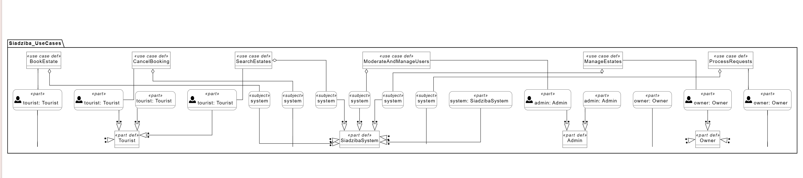

# Описание дизайна программного обеспечения

**Для** Siadziba

**Версия** 0.1

**Подготовила** Огородник Е.В.

**БГУИР**

**2026-11-07**

## Оглавление

1. Введение
2. Обзор дизайна
3. Проектные представления
4. Решения
5. Приложения

## История изменений

| Имя | Дата | Причина изменений | Версия |
|-----|------|-------------------|--------|
| Огородник Е.В. | 2026-11-07 | Первая версия документа | 0.1 |

---

## 1. Введение

### 1.1 Назначение документа

Настоящий документ (SDD) описывает, как будет устроена веб-платформа аренды усадеб Siadziba: из каких частей она состоит, как они взаимодействуют, какие данные хранятся и как выполняются основные сценарии. Он предназначен для разработчика, который будет реализовывать систему, для сопровождающего, который будет её изменять, и для заказчика, который хочет убедиться, что принятые решения отвечают его требованиям. Документ опирается на согласованную спецификацию требований (SRS) и отвечает на вопрос «как», тогда как SRS отвечает на вопрос «что».

Связанные документы: спецификация требований [srs/srs.md](../srs/srs.md), протокол архитектурных решений [adr/adr-siadziba.md](../adr/adr-siadziba.md).

### 1.2 Область применения

Проектируемая система называется Siadziba, версия 1.0 (релизы 1.0–1.2 по разделу 2.6 SRS). Это веб-приложение, в котором туристы находят и бронируют усадьбы, владельцы размещают объекты и управляют календарём занятости, а администратор модерирует объявления. Дизайн связан с бизнес-целями SRS: собрать предложения в одном месте для туристов и помочь владельцам сделать усадьбы узнаваемыми.

В область документа входят: серверная часть на Spring Boot, веб-страницы, формируемые на сервере, схема базы данных PostgreSQL, правила работы с бронями и платежами, интеграции с внешними сервисами. В документ не входят: мобильные приложения, детальная настройка инфраструктуры (DevOps), внутреннее устройство платёжного, почтового и картографического сервисов, а также выбор конкретных провайдеров этих сервисов (он будет сделан на этапе реализации). В учебной версии платёжный сервис представлен заглушкой (см. ADR-003).

### 1.3 Определения, акронимы и сокращения

| Термин | Определение |
|--------|-------------|
| ADR | Architecture Decision Record — запись об архитектурном решении и его обосновании |
| API | Application Programming Interface — набор правил, по которым одна программа обращается к другой |
| BCrypt | Алгоритм хэширования паролей с солью |
| Callback | Обратный вызов: внешний сервис сам отправляет в систему сообщение о результате операции (например, об оплате) |
| CSRF | Cross-Site Request Forgery — атака, при которой пользователя заставляют отправить нежелательный запрос; защита встроена в Spring Security |
| JPA | Java Persistence API — стандарт работы Java-программ с реляционной базой данных |
| MVC | Model-View-Controller — шаблон, разделяющий данные, их отображение и обработку запросов |
| SDD | Software Design Description — документ, описывающий устройство ПО |
| SMTP | Simple Mail Transfer Protocol — протокол отправки электронной почты |
| SRS | Software Requirements Specification — спецификация требований к ПО |
| Thymeleaf | Шаблонизатор Java, формирующий HTML-страницы на сервере |

Предметные термины (бронь, залог, календарь занятости, усадьба и другие) определены в разделе 1.3 SRS.

### 1.4 Ссылки

| Название | Автор / владелец | Версия / дата | Расположение | Тип |
|----------|------------------|---------------|--------------|-----|
| Спецификация требований (SRS) проекта Siadziba | Огородник Е.В. | 0.5 | srs/srs.md | Нормативная |
| Протокол архитектурных решений | Огородник Е.В. | 0.1 | adr/adr-siadziba.md | Нормативная |
| Диаграммы SysMLv2 (варианты использования, главный экран) | Огородник Е.В. | 2026 | pictures/ | Справочная |
| Документация Spring Boot | VMware (Broadcom) | актуальная | https://docs.spring.io/spring-boot/ | Справочная |
| Документация Spring Security | VMware (Broadcom) | актуальная | https://docs.spring.io/spring-security/reference/ | Справочная |
| Документация Thymeleaf | The Thymeleaf Team | актуальная | https://www.thymeleaf.org/documentation.html | Справочная |
| Документация PostgreSQL | PostgreSQL Global Development Group | актуальная | https://www.postgresql.org/docs/ | Справочная |

### 1.5 Обзор документа

Раздел 2 объясняет общий подход к дизайну, перечисляет стейкхолдеров с их задачами и выбранные точки зрения (ракурсы описания системы). Раздел 3 содержит сами проектные представления: каждое имеет номер вида 001-Название, указание точки зрения, описание или диаграмму и ссылки на требования SRS, которые оно реализует. Раздел 4 кратко повторяет ключевые решения, полные записи находятся в ADR. Раздел 5 содержит приложения, в том числе таблицу соответствия требований SRS проектным представлениям. Изменения документа фиксируются в таблице «История изменений».

---

## 2. Обзор дизайна

Siadziba проектируется как одно серверное приложение на Spring Boot («монолит»), которое формирует страницы на сервере (Thymeleaf) и хранит данные в PostgreSQL. Такой подход соответствует масштабу учебного проекта и требованию REQ-DIST-001 (одно приложение, одна база, один сервер). Приложение разделено на логические модули (учётные записи, каталог, бронирования, платежи, уведомления, администрирование) и на слои (контроллеры, сервисы, репозитории, сущности), что обеспечивает сопровождаемость (REQ-MAINT-001). С внешним миром система общается через три интеграции: платёжный сервис, почтовый сервис и ссылку на картографический сервис.

### 2.1 Задачи стейкхолдеров

| Стейкхолдер | Основные задачи | Где адресовано |
|-------------|-----------------|----------------|
| Турист | Быстро найти усадьбу на свободные даты, забронировать без путаницы, безопасно оплатить, знать условия возврата | 001, 005, 006, 009 |
| Владелец | Просто добавлять усадьбы и вести календарь, не получать двойных броней, вовремя узнавать о заявках | 004, 005, 007, 008 |
| Администратор | Проверять объявления, блокировать нарушителей, видеть статистику | 003, 005 |
| Разработчик и сопровождающий | Понятная структура кода и базы данных, возможность изменять систему без поломок | 002, 003, 004, 010 |
| Заказчик | Чтобы правила залога, оплаты и отмены были реализованы так, как согласовано, и в срок | 006, 007, 009 |
| Оператор (эксплуатация) | Простой запуск, резервные копии, журналы, защита данных | 008, 010 |

### 2.2 Выбранные точки зрения

| Точка зрения | Какие задачи адресует | Представления |
|--------------|----------------------|---------------|
| 2.2.1 Контекст | Границы системы, участники и внешние системы | 001 |
| 2.2.2 Композиция | Разделение на модули и распределение ответственности | 002 |
| 2.2.3 Логическое представление | Структура кода: слои и ключевые классы | 003 |
| 2.2.7 Информация | Структура и целостность хранимых данных | 004 |
| 2.2.8 Интерфейс | Адреса страниц, роли, контракты с внешними сервисами | 005 |
| 2.2.9 Взаимодействие | Порядок сообщений в сценарии бронирования и оплаты | 006 |
| 2.2.11 Динамика состояний | Жизненный цикл брони | 007 |
| 2.2.12 Параллелизм | Защита от двойных броней, фоновые задачи | 008 |
| 2.2.10 Алгоритм | Расчёт удержания и возврата денег при отмене | 009 |
| 2.2.14 Развёртывание | Размещение на сервере, резервное копирование, настройки | 010 |

Остальные точки зрения не выбраны по следующим причинам. Физическое представление и ресурсы не требуются, потому что система работает на одном сервере без особых аппаратных ограничений (см. 010). Структура и зависимости не выделены отдельно, так как внутреннее устройство описано через слои и модули (002, 003), а внешние зависимости показаны в контексте (001). Паттерны проектирования (MVC, «сервисный слой», «репозиторий») описаны в представлении 003.

---

## 3. Проектные представления

### 001-Context

**Title:** Контекст системы  
**Viewpoint:** 2.2.1 Контекст  
**Representation:** Система воспринимается как «чёрный ящик». Её используют три роли: турист, владелец и администратор. Система обращается к трём внешним сервисам: платёжному (создание платежа, приём результата, возврат средств), почтовому (отправка уведомлений) и картографическому (система только формирует ссылку с адресом усадьбы, интеграции по API нет).

Связи в контексте таковы: туристы, владельцы и администратор работают с системой через браузер; платёжный сервис отправляет системе результат платежа обратным вызовом (callback); почтовый сервис принимает от системы письма; ссылка на карту открывается в браузере пользователя и обращений системы к картографическому сервису не требует.

Варианты использования показаны на диаграмме SysMLv2:



**More Information:** реализует REQ-FUNC-001–021 (на уровне ролей), REQ-INT-006, REQ-INT-007, REQ-INT-008; см. SRS, раздел 2.1.

### 002-Composition

**Title:** Модули системы  
**Viewpoint:** 2.2.2 Композиция  
**Representation:** Приложение делится на модули, каждый из которых отвечает за свою область. Модули находятся в одном Spring Boot-приложении и общаются вызовами сервисов.

| Модуль | Ответственность | Требования SRS |
|--------|-----------------|----------------|
| accounts | Регистрация, вход, роли, блокировка пользователей | REQ-FUNC-001, 002, 019; REQ-SEC-001, 003; REQ-COMP-002 |
| catalog | Усадьбы, фотографии, удобства, поиск и фильтры, ссылка на карту | REQ-FUNC-003, 004, 005, 006, 007, 015; REQ-INT-007 |
| booking | Календарь занятости, заявки, статусы броней, кабинеты | REQ-FUNC-008, 009, 010, 011, 012, 016, 017 |
| payment | Залог, оплата, возвраты, обмен с платёжным сервисом через интерфейс PaymentGateway (в учебной версии — заглушка) | REQ-FUNC-013, 014; REQ-INT-006 |
| notification | Письма участникам, повторные попытки отправки | REQ-FUNC-021; REQ-INT-008 |
| admin | Модерация объявлений, статистика | REQ-FUNC-018, 020 |

Порядок обращений такой. Запрос из браузера принимает веб-слой (контроллеры и шаблоны Thymeleaf) и передаёт его нужному модулю: accounts, catalog, booking или admin. Модуль booking обращается к модулям payment (деньги) и notification (письма), модуль admin тоже отправляет письма через notification. Все модули хранят данные в одной базе PostgreSQL. Модуль payment общается с платёжным сервисом, модуль notification — с почтовым сервисом.

**More Information:** решение об одном приложении — ADR-001, REQ-DIST-001; решение о способе формирования страниц — ADR-005.

### 003-Layers

**Title:** Слои и ключевые классы  
**Viewpoint:** 2.2.3 Логическое представление  
**Representation:** В каждом модуле используется одна и та же слоистая структура.

| Слой | Назначение | Примеры классов |
|------|-----------|-----------------|
| Controllers | Принимают HTTP-запросы, проверяют ввод, выбирают шаблон страницы | AuthController, CatalogController, OwnerEstateController, BookingController, PaymentController, AdminController |
| Services | Бизнес-правила, транзакции | AccountService, EstateService, AvailabilityService, BookingService, RefundCalculator, PaymentService, PaymentGateway (интерфейс) с реализацией MockPaymentGateway, NotificationService, ModerationService, StatsService |
| Repositories | Доступ к базе данных (Spring Data JPA) | UserRepository, EstateRepository, BookingRepository, PaymentRepository и другие |
| Entities | Классы, отображаемые на таблицы | User, Estate, Photo, Amenity, BlockedDate, Booking, Payment |

Правила: контроллеры не обращаются к репозиториям напрямую, вся бизнес-логика находится в сервисах, а сущности содержат только данные и простые проверки. Применяются шаблоны MVC, «сервисный слой» и «репозиторий».

Интерфейс пользователя состоит из страниц Thymeleaf с общими фрагментами (шапка, подвал, форма поиска) и адаптивной вёрсткой на CSS (flexbox и grid), что обеспечивает работу на экранах от 360 до 1920 пикселей (REQ-INT-001). Ошибки ввода проверяются средствами Spring Validation, а единый обработчик ошибок (@ControllerAdvice) показывает понятные сообщения без технических деталей (REQ-INT-003). Для фотографий в шаблонах обязателен атрибут alt (REQ-INT-004). Безопасность обеспечивает Spring Security: хэширование паролей BCrypt (REQ-SEC-001), проверка ролей на уровне адресов и методов (REQ-SEC-003), защита от CSRF, экранирование вывода шаблонами и параметризованные запросы JPA (REQ-SEC-005).

**More Information:** REQ-MAINT-001, REQ-INT-001–004, REQ-SEC-001, 003, 005.

### 004-Data-Model

**Title:** Модель данных  
**Viewpoint:** 2.2.7 Информация  
**Representation:** Данные хранятся в PostgreSQL. Основные таблицы и связи описаны ниже (общий словарь данных — приложение А SRS).

| Таблица | Основные поля | Описание |
|---------|---------------|----------|
| users | id (bigint, первичный ключ), name, email (уникальный), password_hash, phone, role, is_blocked (boolean), consent_accepted_at (timestamp) | Все пользователи системы |
| estates | id, owner_id (ссылка на users), title, description (text), region, address, latitude, longitude, price_per_night (numeric), check_in_time, check_out_time (time), capacity (int), status, reject_reason | Усадьбы |
| amenities | id, name | Справочник удобств |
| estate_amenities | estate_id, amenity_id | Связь усадеб и удобств (многие ко многим) |
| photos | id, estate_id, file_path, sort_order | Фотографии усадьбы |
| blocked_dates | id, estate_id, date_from, date_to (date) | Периоды, закрытые владельцем вручную |
| bookings | id, estate_id, tourist_id (ссылка на users), check_in_date, check_out_date (date), guests, total_price, deposit_amount (numeric), payment_option, status, payment_deadline, created_at (timestamp) | Заявки и брони |
| payments | id, booking_id, type, amount (numeric), status, external_id (уникальный), created_at | Денежные операции по брони |

Связи между таблицами: у одного пользователя-владельца может быть много усадеб, а у одного пользователя-туриста — много броней. У одной усадьбы может быть много броней, фотографий и закрытых периодов. Усадьба и удобство связаны отношением «многие ко многим» через таблицу estate_amenities. К одной брони относится несколько платежей (залог, оплата, возврат).

Связь «усадьба — удобство» (многие ко многим) реализуется таблицей estate_amenities (estate_id, amenity_id).

Значения перечислений: роль пользователя — TOURIST, OWNER, ADMIN; статус усадьбы — ON_REVIEW, PUBLISHED, REJECTED, UNPUBLISHED; статус брони — AWAITING_CONFIRMATION, AWAITING_PAYMENT, BOOKED, DECLINED, CANCELLED, COMPLETED; способ оплаты — FULL_ONLINE, DEPOSIT_ONLINE; тип платежа — DEPOSIT, FULL, REFUND.

Ограничения целостности: уникальная почта пользователя; цена и вместимость больше нуля; дата выезда позже даты заезда; уникальный внешний номер платежа (защита от повторной обработки); исключающее ограничение, запрещающее пересечение периодов у броней одной усадьбы в статусах AWAITING_PAYMENT и BOOKED (см. 008). Пароли хранятся только как password_hash. Номера банковских карт в базе не хранятся (REQ-SEC-004). Пользователь может удалить аккаунт, при этом данные о завершённых бронях обезличиваются (REQ-COMP-001).

Ключевой запрос поиска (REQ-FUNC-004): усадьба подходит под выбранные даты, если для неё нет брони в статусах AWAITING_PAYMENT или BOOKED и нет закрытых дат, пересекающихся с периодом. Для скорости (REQ-PERF-001, 002) создаются индексы по региону, цене и по периодам броней, а список выводится страницами по 20 усадеб.

**More Information:** REQ-FUNC-003–014, REQ-SEC-001, 004, 006, REQ-COMP-001, 002, REQ-PERF-001, 002; ADR-002, ADR-004.

### 005-Web-Interface

**Title:** Адреса страниц и внешние интерфейсы  
**Viewpoint:** 2.2.8 Интерфейс  
**Representation:** Веб-интерфейс состоит из адресов (маршрутов), доступных разным ролям.

| Метод и адрес | Кто имеет доступ | Назначение | Требования |
|---------------|------------------|------------|------------|
| GET / | Все | Каталог усадеб с поиском и фильтрами | REQ-FUNC-003, 004 |
| GET /estates/{id} | Все | Карточка усадьбы, календарь, кнопка маршрута | REQ-FUNC-005, 008, 015 |
| GET, POST /register | Все | Регистрация с согласием на обработку данных | REQ-FUNC-001, REQ-COMP-002 |
| GET, POST /login, POST /logout | Все | Вход и выход | REQ-FUNC-002 |
| POST /bookings | Турист | Отправка заявки на бронирование | REQ-FUNC-010 |
| GET /my/bookings | Турист | Список броней и их статусов | REQ-FUNC-016 |
| POST /my/bookings/{id}/pay | Турист | Выбор способа оплаты и переход к платёжному сервису | REQ-FUNC-013 |
| POST /my/bookings/{id}/cancel | Турист | Отмена брони, показ суммы возврата | REQ-FUNC-014 |
| POST /payments/callback | Платёжный сервис | Получение результата платежа (проверка подписи) | REQ-INT-006, REQ-FUNC-013 |
| GET /owner/estates, GET, POST /owner/estates/new, POST /owner/estates/{id}/edit, POST /owner/estates/{id}/unpublish | Владелец | Управление своими усадьбами | REQ-FUNC-006, 007, 017 |
| POST /owner/estates/{id}/blocked-dates, POST /owner/estates/{id}/blocked-dates/{dateId}/delete | Владелец | Закрытие и открытие дат | REQ-FUNC-009 |
| GET /owner/requests, POST /owner/bookings/{id}/confirm, POST /owner/bookings/{id}/decline | Владелец | Входящие заявки, подтверждение и отклонение | REQ-FUNC-011, 017 |
| GET /admin/moderation, POST /admin/estates/{id}/approve, POST /admin/estates/{id}/reject | Администратор | Модерация объявлений | REQ-FUNC-018 |
| POST /admin/users/{id}/block, POST /admin/users/{id}/unblock | Администратор | Блокировка и разблокировка | REQ-FUNC-019 |
| GET /admin/stats | Администратор | Общая статистика | REQ-FUNC-020 |

Доступ к адресам проверяется по роли (REQ-SEC-003), а к своим объектам (усадьбам, броням) — ещё и по владельцу записи. Контакты (телефон и почта) выводятся в шаблоне только для броней в статусе BOOKED (REQ-SEC-006).

Контракты с внешними сервисами:

1. Платёжный сервис. Система создаёт платёж на сумму залога или полной оплаты и перенаправляет туриста на страницу оплаты провайдера, данные карты вводятся только там. Результат приходит запросом POST /payments/callback, подпись запроса проверяется секретным ключом. Для возврата система отправляет провайдеру запрос на возврат суммы по внешнему номеру платежа. Все обращения к провайдеру идут через интерфейс PaymentGateway (создать платёж, запросить возврат). В учебной версии используется заглушка MockPaymentGateway: она возвращает ссылку на страницу с кнопками «Оплатить» и «Отклонить» (без ввода данных карты), а после нажатия отправляет в систему такой же подписанный callback на тестовом ключе. Реализация выбирается настройкой (например, payment.provider=mock), страница заглушки доступна только в учебном режиме. Настоящие деньги в учебной версии не списываются.
2. Почтовый сервис (SMTP). Система отправляет текстовые письма, при ошибке повторяет отправку не менее трёх раз с паузой (REQ-INT-008).
3. Картографический сервис. Система подставляет адрес или координаты усадьбы в шаблон ссылки и открывает её в новой вкладке (REQ-INT-007, REQ-FUNC-015).

**More Information:** ADR-003 (платёжная интеграция), ADR-005 (формирование страниц на сервере).

### 006-Booking-Flow

**Title:** Сценарий бронирования и оплаты  
**Viewpoint:** 2.2.9 Взаимодействие  
**Representation:** Основной сценарий («счастливый путь») от заявки до оплаты.

| Шаг | Кто действует | Что происходит |
|-----|---------------|----------------|
| 1 | Турист | Отправляет заявку на бронирование |
| 2 | Система | Сохраняет бронь в статусе «Ожидает подтверждения», отправляет письмо владельцу |
| 3 | Владелец | Подтверждает заявку |
| 4 | Система | Блокирует строку усадьбы, проверяет, что даты свободны, переводит бронь в статус «Ожидает оплаты» и записывает срок оплаты (12 часов), отправляет туристу письмо |
| 5 | Турист | Выбирает способ оплаты: полная оплата на сайте или только залог |
| 6 | Система | Создаёт платёж в платёжном сервисе и перенаправляет туриста на страницу оплаты |
| 7 | Турист | Оплачивает на странице платёжного сервиса (данные карты вводятся только там) |
| 8 | Платёжный сервис | Отправляет системе результат платежа (callback) |
| 9 | Система | Проверяет подпись, переводит бронь в статус «Забронирована», сохраняет платёж, отправляет письма туристу и владельцу |

Пути отказа: если выбранные даты заняты, заявка или подтверждение отклоняются с понятным сообщением (REQ-FUNC-010, 012); если платёж отклонён, бронь остаётся в статусе «Ожидает оплаты» и оплату можно повторить; если платёжный сервис недоступен, пользователь видит сообщение, а статус не меняется (REQ-REL-002); если оплата не поступила за 12 часов, бронь автоматически отменяется (см. 008). При отмене туристом система рассчитывает сумму возврата (см. 009), запрашивает возврат у платёжного сервиса, освобождает даты и отправляет письма (REQ-FUNC-014, 021).

**More Information:** REQ-FUNC-010–014, 021; REQ-INT-006, 008; REQ-REL-002.

### 007-Booking-States

**Title:** Состояния брони  
**Viewpoint:** 2.2.11 Динамика состояний  
**Representation:** Бронь проходит через следующие состояния (таблица переходов — приложение Б SRS).

| Из состояния | Событие | В состояние |
|--------------|---------|-------------|
| (начало) | Турист отправил заявку | Ожидает подтверждения |
| Ожидает подтверждения | Владелец подтвердил заявку | Ожидает оплаты |
| Ожидает подтверждения | Владелец отказал | Отклонена |
| Ожидает подтверждения | Турист отозвал заявку | Отменена |
| Ожидает оплаты | Залог или оплата внесены | Забронирована |
| Ожидает оплаты | Прошло 12 часов без оплаты или турист отменил бронь | Отменена |
| Забронирована | Турист отменил бронь | Отменена |
| Забронирована | Прошла дата выезда | Завершена |

Состояния «Отклонена», «Отменена» и «Завершена» конечные, из них переходов нет.

Даты усадьбы заняты, пока бронь находится в состояниях «Ожидает оплаты» и «Забронирована». Состояния «Отклонена», «Отменена» и «Завершена» конечные. Все переходы выполняет BookingService, остальные модули состояние напрямую не меняют.

**More Information:** REQ-FUNC-010–014, REQ-FUNC-016, 017.

### 008-Concurrency

**Title:** Параллельная работа и фоновые задачи  
**Viewpoint:** 2.2.12 Параллелизм  
**Representation:** Опасная ситуация: двое туристов одновременно получают подтверждение на одни даты или владелец закрывает даты в момент подтверждения заявки. Защита двухуровневая.

Первый уровень — приложение. Подтверждение заявки, ручное закрытие дат и создание брони выполняются в транзакции, которая начинается с блокировки строки усадьбы (SELECT … FOR UPDATE). Пока транзакция не завершена, другая операция по этой же усадьбе ждёт. Внутри блокировки проверяется отсутствие пересекающихся броней в статусах «Ожидает оплаты» и «Забронирована» и закрытых дат, и только затем статус меняется.

Второй уровень — база данных. На таблице броней создаётся исключающее ограничение PostgreSQL (EXCLUDE USING gist по усадьбе и диапазону дат для статусов AWAITING_PAYMENT и BOOKED), поэтому даже при ошибке в коде пересекающиеся брони не будут сохранены.

Повторная обработка платежа: результат платежа с уже известным внешним номером игнорируется (уникальное поле external_id), поэтому повторный callback не приводит к двойному списанию или двойной смене статуса.

Фоновые задачи (планировщик Spring):

| Задача | Периодичность | Действие |
|--------|---------------|----------|
| Отмена неоплаченных броней | Каждые 5 минут | Брони в статусе «Ожидает оплаты» с истёкшим сроком (12 часов) переводятся в «Отменена», даты освобождаются, туристу уходит письмо |
| Завершение броней | Раз в сутки | Брони в статусе «Забронирована», у которых прошла дата выезда, переводятся в «Завершена» |
| Повтор отправки писем | Каждую минуту | Неотправленные письма отправляются повторно, не более трёх попыток |

**More Information:** REQ-FUNC-012, 013; REQ-REL-001, 002; ADR-004.

### 009-Refund-Algorithm

**Title:** Расчёт возврата денег при отмене  
**Viewpoint:** 2.2.10 Алгоритм  
**Representation:** Алгоритм реализуется классом RefundCalculator (модуль payment) и реализует правила REQ-FUNC-014.

```
total     = booking.total_price
deposit   = round(total * 0.10, 2)
paid      = сумма успешных платежей типов DEPOSIT и FULL по этой брони
hoursLeft = часов от текущего момента до (check_in_date + estate.check_in_time)

если hoursLeft >= 24:  withheld = deposit
иначе если hoursLeft > 0:  withheld = round(total * 0.50, 2)
иначе:  withheld = total

refund = max(0, paid - withheld)
```

Пример (стоимость брони 10 000 руб., оплачена полностью): при отмене за 3 дня удерживается 1 000 руб., возврат 9 000 руб.; за 5 часов удерживается 5 000 руб., возврат 5 000 руб.; после времени заезда возврат 0 руб. Если оплачен только залог (1 000 руб.), то paid меньше удержания, и возврат равен 0 при любом сроке. Перед подтверждением отмены система показывает туристу рассчитанную сумму. Расчёт выполняется в одном месте, чтобы правило нельзя было применить по-разному на разных страницах.

**More Information:** REQ-FUNC-013, 014; приложение В SRS.

### 010-Deployment

**Title:** Развёртывание  
**Viewpoint:** 2.2.14 Развёртывание  
**Representation:** Система работает на одном сервере: приложение запускается как один исполняемый JAR-файл (Java 17 и выше), рядом работает PostgreSQL, а перед приложением стоит обратный прокси, обеспечивающий HTTPS (REQ-SEC-002).

Схема запросов такая: браузер пользователя обращается по HTTPS к обратному прокси, прокси передаёт запрос приложению Siadziba, приложение работает с базой PostgreSQL, обращается по HTTPS к платёжному сервису и отправляет письма через почтовый сервер по SMTP. С базы данных ежедневно снимается копия командой pg_dump.

Сборка выполняется одной командой Maven из исходного кода в репозитории Git (REQ-BUILD-001). Настройки окружения (пароль базы данных, ключи платёжного сервиса, данные почтового сервера) передаются через переменные окружения и не хранятся в репозитории. Ежедневная резервная копия базы создаётся командой pg_dump по расписанию, копии хранятся отдельно от рабочей базы, восстановление проверяется на тестовом сервере (REQ-REL-003). Журнал приложения пишется в файл с ротацией, в него попадают ошибки и ключевые события (вход, изменения броней, результаты платежей и возвратов, отправка писем), но не попадают пароли и данные карт (REQ-OBS-001, 002). Инструкция запуска хранится в README репозитория (REQ-INST-001). В учебной версии платёжный сервис заменён заглушкой внутри приложения, поэтому внешний доступ к платёжному провайдеру не нужен. Работа в контейнерах (Docker) не требуется, но не запрещена; сервер должен запускаться и на Windows, и на Linux (REQ-PORT-001).

**More Information:** REQ-INST-001, REQ-BUILD-001, REQ-DIST-001, REQ-PORT-001, REQ-SEC-002, REQ-REL-003, REQ-OBS-001, 002, REQ-AVAIL-001.

---

## 4. Решения

В этом разделе кратко повторены ключевые решения, полные записи находятся в [adr/adr-siadziba.md](../adr/adr-siadziba.md).

**ID:** 001-Spring-Boot  
**Title:** Серверная часть на Java и Spring Boot  
**Context:** Нужно выбрать технологию серверной части, удовлетворяющую ограничению SRS (раздел 2.3) и обеспечивающую безопасность, работу с базой и фоновые задачи.  
**Options:** Java + Spring Boot; Node.js (NestJS); Python (Django).  
**Outcome:** Выбран «Java + Spring Boot», потому что это обязательное ограничение SRS, а Spring Security, Spring Data JPA и планировщик закрывают основные потребности без сторонних решений.  
**More Information:** ADR-001.

**ID:** 002-PostgreSQL  
**Title:** Хранение данных в PostgreSQL  
**Context:** Данные о бронях и платежах должны храниться надёжно, а пересечения дат должны отсекаться самой базой.  
**Options:** PostgreSQL; MySQL; MongoDB.  
**Outcome:** Выбран «PostgreSQL», потому что он обеспечивает транзакции (ACID) и исключающие ограничения по диапазонам дат, а также указан в ограничениях SRS.  
**More Information:** ADR-002.

**ID:** 003-External-Payment  
**Title:** Приём платежей через внешний сервис  
**Context:** Система должна принимать залог и оплату, не храня данные банковских карт (REQ-SEC-004).  
**Options:** страница оплаты провайдера с перенаправлением; форма карты, встроенная в сайт; собственная обработка карт.  
**Outcome:** Выбрана «страница оплаты провайдера с перенаправлением», потому что данные карты не попадают на сервер системы. В учебной версии провайдер заменён заглушкой за интерфейсом PaymentGateway, поэтому при подключении настоящего сервиса меняется только одна реализация.  
**More Information:** ADR-003.

**ID:** 004-Double-Booking-Protection  
**Title:** Защита от двойных броней  
**Context:** Двойное бронирование — главная проблема, которую решает продукт (REQ-FUNC-012, REQ-REL-001).  
**Options:** проверка только в коде приложения; блокировка строки усадьбы и ограничение в базе; оптимистичная блокировка по версии; максимальный уровень изоляции транзакций.  
**Outcome:** Выбрана «блокировка строки усадьбы и ограничение в базе», потому что защита работает на двух уровнях и не зависит от аккуратности кода.  
**More Information:** ADR-004.

**ID:** 005-Server-Side-Rendering  
**Title:** Страницы, формируемые на сервере (Thymeleaf)  
**Context:** Нужен пользовательский интерфейс, который работает в браузере, подходит для публичного каталога и не усложняет развёртывание.  
**Options:** Thymeleaf; React (одностраничное приложение).  
**Outcome:** Выбран «Thymeleaf», потому что приложение остаётся единым (REQ-DIST-001), публичные страницы удобны для поисковых систем, а интерфейс проще сопровождать.  
**More Information:** ADR-005.

---

## 5. Приложения

### Приложение А. Соответствие требований SRS проектным представлениям

| Требования SRS | Проектные представления и решения |
|----------------|-----------------------------------|
| REQ-INT-001–005 | 003, 005 |
| REQ-INT-006 | 002, 005, 006, ADR-003 |
| REQ-INT-007 | 005 |
| REQ-INT-008 | 002, 005, 008 |
| REQ-FUNC-001, 002 | 002, 003, 004, 005 |
| REQ-FUNC-003, 004, 005 | 002, 004, 005 |
| REQ-FUNC-006, 007 | 002, 004, 005 |
| REQ-FUNC-008, 009 | 004, 005, 008 |
| REQ-FUNC-010, 011, 012 | 006, 007, 008, ADR-004 |
| REQ-FUNC-013, 014 | 006, 007, 009, ADR-003 |
| REQ-FUNC-015 | 005 |
| REQ-FUNC-016, 017 | 005, 007 |
| REQ-FUNC-018, 019, 020 | 002, 004, 005 |
| REQ-FUNC-021 | 002, 006, 008 |
| REQ-PERF-001, 002 | 004, 010 |
| REQ-SEC-001–006 | 003, 004, 005, 010, ADR-003 |
| REQ-REL-001, 002, 003 | 006, 008, 010, ADR-004 |
| REQ-AVAIL-001, REQ-OBS-001, 002 | 010 |
| REQ-COMP-001, 002 | 004, 005 |
| REQ-INST-001, REQ-BUILD-001, REQ-DIST-001, REQ-PORT-001 | 002, 010 |
| REQ-MAINT-001 | 003 |
| REQ-COST-001 | ADR-001, ADR-002, ADR-005 |

### Приложение Б. Открытые вопросы дизайна

Платёжный сервис в учебной версии представлен заглушкой (MockPaymentGateway). Конкретные платёжный, почтовый и картографический сервисы будут выбраны на этапе реализации, после этого в разделы 005 и 010 будут добавлены их адреса и параметры. Точный размер залога (сейчас 10 % стоимости) и срок на оплату (сейчас 12 часов) могут быть изменены по результатам обсуждения с заказчиком, тогда нужно будет обновить представления 006, 008 и 009.
